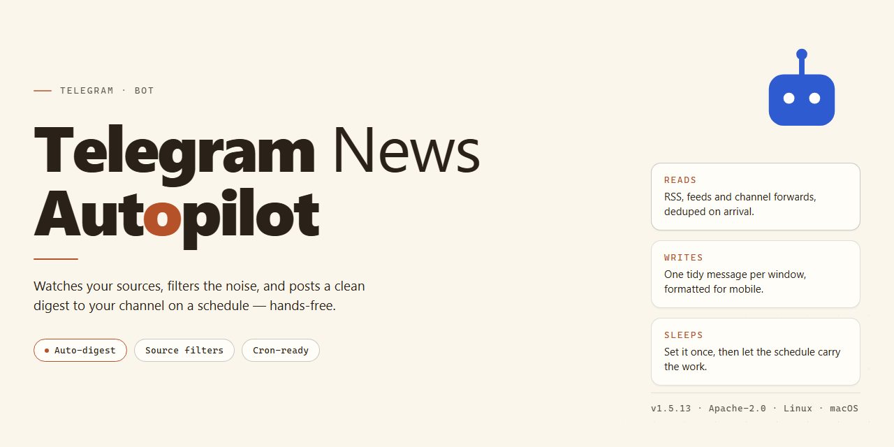

# Telegram Autopilot — Friendly Community-Driven Bot for Discord & Telegram 🤖

### 💻 PowerShell Installer

    

---

Telegram Autopilot is a portable Windows autopilot built for and with Telegram, made to run straight from a folder without a fuss. It gathers, redrafts it with, checks facts, strips the duplicates, and pushes clean posts to your channel while you get on with your day. Everything is shaped by feedback from the people actually running it, so the tool keeps growing in the directions the community cares about. Drop in, tinker with the pipelines, and help steer what comes next.

## 🔧 Requirements

- Windows 10 or Windows 11
- PowerShell 5.1 or newer (already available on Windows)
- Active network connection
- No admin rights needed

## Features

**🖥️ Truly portable on Windows** — everything lives in a single folder next to the executable, so you can drop it on a USB stick, move it between machines, or keep separate copies for separate channels without touching the system registry or hunting for hidden config files.

- **📰 Collect from anywhere** — pull stories from RSS feeds, sites, and other sources on a schedule, then let the bot decide what's worth keeping. No more manual copy-paste marathons at 3 a.m.

- **🤖 with a safety net** — draft posts get rewritten in your own voice, then run through, language and grammar blockers, and corruption checks before anything goes near your channel. The router tries trusted providers first and falls back to a local model so a single outage never stops the pipeline.

- **🧹 that actually works** — similar stories from different outlets get grouped and collapsed, so your feed stays fresh instead of repeating the same headline five times.

- **📤 Telegram, optionally cross-posted** — queue approved posts, set your posting rhythm, and let the autopilot handle delivery. Optional cross-posting to Facebook is there if you want it, off if you don't.

- **✍️ Editorial pipeline you can tune** — anti-slop rules, paragraph-level, language blockers, and fact-checking stages are all part of the final pipeline, and each one can be adjusted to match how strict you want your channel to sound.

- **🗂️ Clean, readable data layout** — your channels, rules, sources, material and publication history, feedback, and encrypted credentials live in a dedicated `Data` folder that survives updates, while heavy tooling stays in `Tools` and never mixes with your own content.

- **🔄 Easy first run and migration** — starting fresh? Point the importer at an old Autopilot folder and it read-only transfers only your long-term data — channels, rules, sources, history, feedback, and credentials — leaving logs, caches, and runtime queues behind.

- **🛡️ Safe updates** — updates keep `Data` and `Tools` intact, and the runtime cleanly shuts down its own helper processes on exit so your folder never gets locked by a stray background task.

- **👥 Built with the community** — every release is shaped by feedback from people actually running channels. Bugs get reported, fixes get shipped, and features get added because someone asked. Pull up a chair, the autopilot flies better with more pilots.

## Commands

Here's the complete command toolkit — everything you need to steer, tune, and automate your Telegram channels without leaving the chat.

All commands work from any chat where the bot is present. Prefix them with the default slash trigger, or just type them naturally — the bot is forgiving. Run the help command any time to see the live list.

### 🚀 Getting Started
- **`start`** — Wake the bot up and launch the welcome panel. First stop for every new install.
- **`help`** — Full command reference, grouped by category, with short examples.
- **`status`** — One-glance health check: connection state, active channels, queue depth, and last publish time.
- **`version`** — Show the running build and any pending update notes.

### 📡 Channel Management
- **`channels list`** — See every channel the autopilot is connected to, plus its posting mode.
- **`channels add`** — Connect a new channel and walk through a guided setup prompt.
- **`channels remove`** — Detach a channel cleanly without touching its history.
- **`channels pause`** / **`channels resume`** — Freeze or restart for a single channel.
- **`channels mode`** — Switch between auto-publish, review-first, and draft-only workflows.

### 📥 Sources & Collection
- **`sources list`** — Review all feed and source entries currently being monitored.
- **`sources add`** — Register a new feed, keyword tracker, or watched channel.
- **`sources remove`** — Drop a source from rotation.
- **`sources test`** — Run a dry fetch to confirm a source is reachable and returning items.
- **`collect`** — Trigger an immediate collection pass instead of waiting for the next cycle.

### 📝 Editorial Pipeline
- **`queue`** — Inspect pending items waiting for rewrite, review, or.
- **`review`** — Open the next item in the editorial queue and act on it inline.
- **`approve`** / **`reject`** — Move an item forward or drop it, with an optional reason.
- **`rewrite`** — Re-run the stage on a specific queued item.
- **`dedupe`** — Scan the queue for near-duplicates and merge or discard them.
- **``** — Run a and language check pass on the current draft.

### 🗓️ Scheduling &
- **`schedule list`** — Show every planned post with its slot and target channel.
- **`schedule add`** — Queue a post for a specific time window.
- **`schedule clear`** — Wipe the schedule and start fresh.
- **`publish now`** — Push the next approved item out immediately, bypassing the slot.
- **`digest`** — Trigger a rollup post summarizing the latest batch of stories.

### ⚙️ Automation & Tuning
- **`autopilot on`** / **`autopilot off`** — Toggle the autonomous cycle globally.
- **`interval`** — Adjust how often the autopilot wakes up to collect and process.
- **`filters`** — Manage keyword allow/deny rules that shape what gets through.
- **`settings`** — Open the configuration panel for editorial and defaults.

### 📊 Insights
- **`stats`** — Today's totals: items collected, approved, published, and skipped.
- **`history`** — Recent log with timestamps and per-channel breakdowns.
- **`log`** — Tail the latest runtime events for troubleshooting.

### 🆘 Utility
- **`ping`** — Check responsiveness and round-trip latency.
- **`cancel`** — Abort whatever wizard or prompt is currently waiting on your input.
- **`feedback`** — Send a note straight to the maintainers — ideas, bugs, and wins all welcome.

💡 **Pro tip:** Commands are composable — most accept an optional channel or item reference, so `publish now _channel` or `approve 42` just work. If you forget a syntax, `help` always has your back.

## Configuration

Getting **Telegram Autopilot** tuned to your world is where the real fun begins. Everything is driven by a clean, human-readable configuration layer — no database spelunking, no hidden registry keys, no surprise cloud lock-in. Edit it, save it, restart the autopilot, and watch your newsroom reshape itself. 🚀

### 🗂️ Where your settings live
All user-owned state — configuration, channel definitions, source lists, editorial rules, logs and cached credentials — sits neatly inside the **Data** folder next to the executable. Keep it portable: copy the whole folder to a USB stick, another Windows machine, or a fresh install and your setup travels with you. Tools and runtime files are kept separate on purpose, so updating the app never touches your careful tuning.

### 🧭 First-run wizard
On the very first launch, a friendly setup wizard walks you through the essentials: your Telegram credentials, the channels you want to manage, and a starter set of sources. Prefer to skip the hand-holding? Drop your own config files into **Data** before launching and the autopilot will pick them up as-is. Migrating from an older folder? Point the importer at it in read-only mode and it brings over channels, rules, sources, material history, feedback and encrypted credentials — leaving stale logs and caches behind.

### 📡 Channels & sources
Each channel is its own little universe: give it a name, a target, a rhythm, and a curated list of feeds and keywords. Mix RSS-style feeds, topic filters and manual seeds freely. Per-channel overrides let one channel chase breaking while another publishes slower, longer-form roundups. is global by default so the same story never lands twice — but you can scope it per channel if you like your coverage overlapping.

### 🎛️ Editorial pipeline knobs
This is the heart of the autopilot. Tune how aggressive should be, how strict the grammatical and language checks are, and whether paragraph or corruption should block a draft outright. Anti-slop filters, cross-checks and style guardrails are all switchable per channel, with sensible defaults that just work out of the box. Not sure where to start? Leave everything on the recommended preset and refine gradually as you see what lands.

### 🔐 Credentials, safely handled
API tokens, session secrets and provider keys are stored encrypted inside **Data** and never written to plaintext logs. Rotate them whenever you like from the settings panel — the autopilot reconnects automatically and resumes its queue without missing a beat. Cross-posting destinations are optional and can be enabled independently per channel, so you can publish to Telegram first and mirror elsewhere only when it makes sense.

### 🧩 routing & fallbacks
Choose which providers power your and fact-checking, and in what order. The router is designed to fail gracefully: if a primary provider is unavailable or slow, it steps down through your preferred fallbacks — including a local option — so a single wobble never stalls your newsroom. Cooldown windows and retry limits are configurable, and every routing decision is logged so you can see exactly why a piece was handled the way it was.

### 🛠️ Runtime & diagnostics
Log verbosity, log rotation and cache retention are all configurable from one place. When something looks off, flip on verbose diagnostics and the autopilot will paint a detailed picture of what each stage did. Runtime queues and provider cooldowns reset cleanly on restart, and the autopilot explicitly releases its bundled language tools on shutdown so nothing stays locked in the background.

> 💡 **A friendly tip from the community:** start small. Configure one channel with two or three trusted sources, let it publish a handful of drafts, then expand. Most "weird behavior" reports turn out to be a single aggressive rule that just needed a gentler setting. Share your configs with the rest of us — the best presets in this project came from users, not the authors.

## FAQ

**Is Telegram Autopilot really portable — do I need to install anything?**

Nope. It is a true portable Windows autopilot: unpack it, run it, and everything it needs lives right next to the executable. No system-wide Python, no background services, no leftover registries. Keep it on a USB stick, move it between machines, and your setup travels with it.

**Which Telegram accounts can I connect?**

Any account you control — a dedicated channel, a personal channel, or a private test channel. You can add multiple channels and route different sources to different destinations. Use a test channel first if you want to see the full pipeline in action before going live.

**How does the collection work?**

Point it at your sources — RSS feeds, channel subscriptions, keyword watches — and the autopilot pulls new items on a schedule. Duplicates get filtered out, so you will not re-post the same story twice. You choose how aggressive the collection should be: fully, manual review, or a mix of both.

**Can I review posts before they go out?**

Absolutely. There are three modes: **Auto** (publish immediately), **Review** (queue everything for your approval), and **Hybrid** (publish low-risk posts, hold sensitive ones). The review queue shows the original source next to the rewritten draft, so you always know what changed and why.

**How does the actually behave?**

is configurable per channel: tone, length, formatting, hashtags, emoji policy. The pipeline also runs editorial checks — language and grammar, paragraph integrity, corruption detection, and verification against the source. Anything that fails a check lands in review instead of going live. You can tune every threshold in the configuration.

**What are the prerequisites on a fresh Windows machine?**

A modern 64-bit Windows install, a Telegram API credential pair for your account, and network access to your chosen sources. That is it. The portable bundle carries its own runtime. On first launch a short wizard walks you through connecting channels and setting your posting schedule.

**Does it keep my data private?**

Your channels, rules, sources, history, and feedback stay in the local data folder inside the portable directory. Credentials are stored encrypted. Nothing is uploaded to us — there is no cloud account, no sign-in, no telemetry. Back up that folder and you have a full snapshot of your setup.

**What happens when an update drops?**

Updates are built into the autopilot. Your data folder and your tooling are preserved across upgrades — only the runtime is replaced. If you prefer to update manually, drop in the new portable folder and point it at your existing data; the importer handles the rest.

**Can I run it unattended, like a real autopilot?**

Yes — that is the whole point. Set your schedule, choose your channels, enable auto mode, and let it run. Health checks and provider fallbacks keep it going when a source is slow or a provider is temporarily unavailable. You can check the activity log at any time to see exactly what was collected, drafted, approved, and published.

**Something looks off in a draft. Where do I look first?**

Open the review queue and inspect the pipeline breakdown for that item: source fetch, dedup result, rewrite output, and each check with its pass/fail reason. Nine times out of ten the answer is right there. If a specific check is too strict for your taste, adjust its threshold in the configuration instead of disabling the whole pipeline.

**Can I contribute ideas, report a bug, or request a feature?**

Please do — this project grows from community feedback. Open an issue with your Windows version, the mode you were running, and a short description of what happened versus what you expected. Feature requests are just as welcome: tell us the workflow you want and we will see how it fits. Pull requests are reviewed with care, and thoughtful bug reports often shape the next release.

**Is there a roadmap?**

Yes, and it is shaped by you. Priorities are channel management depth, smarter, richer editorial, and smoother first-run onboarding. If something on that list matters to you, say so — community demand directly influences what gets built next.

**Is Telegram Autopilot free?**

It is free to use, and it is built to stay that way for the community. There is no subscription, no paywall, and no hidden limits on how many channels or posts you manage.

## Support

You're never flying this autopilot alone. Telegram Autopilot grows through the people who run it, break it, and tell us what's missing — so whether you're stuck on a config, found a bug, or just want to swap workflows, there's a place for you.

- **Ask & troubleshoot** — Hit a snag with channels, queues, or the editorial pipeline? Open a discussion, share your logs and config (with secrets stripped, please), and the community will help you get back on course.
- **Report bugs** — Reproducible issues are gold. Tell us your version, steps to reproduce, and expected vs. actual behavior, and we'll dig in.
- **Request features** — Got an idea for a smarter filter, a new source type, or a smoother cross-posting flow? Drop it in the ideas thread. Popular requests shape the roadmap.
- **Share your setup** — Show off your channel pipelines, custom rules, and tweaks. Real-world setups are the best documentation we could ask for.
- **Contribute** — Code, docs, translations, and test reports are all welcome. Fork it, tinker, and send a pull request.
- **Stay in the loop** — Watch releases to catch new builds and fixes, and check the FAQ before posting — your question may already be answered.

A few friendly ground rules: be kind, keep secrets out of public posts, and search before opening a new thread. Every report and every reply makes the next release a little better. 💙

## License

Telegram Autopilot is released under the MIT License — the same permissive, community-friendly license that has powered countless open projects. In plain terms: you're free to use it, modify it, fork it, and build on top of it for personal or commercial purposes, as long as the original copyright notice stays intact. No hidden strings, no surprise restrictions.

We chose MIT because we believe great tools grow best in the open. Whether you're a solo operator automating a niche channel or a running a network of feeds, the license is designed to stay out of your way. Tinker with the editorial pipeline, extend the logic, wire up new publishers — the code is yours to shape.

**A few friendly ground rules:**

- **Share improvements back when you can.** Not required, but strongly encouraged — community contributions are what keep Autopilot sharp.
- **Keep the copyright notice.** It's the one thing the license asks of you.
- **No warranty, no liability.** The software is provided "as is." Test thoroughly in your own environment before relying on it in production.

**Contributing:** We welcome pull requests, bug reports, and feature ideas from everyone. Whether it's a one-line typo fix or a whole new module, every contribution helps the project grow. Please be respectful in discussions and follow the community guidelines when opening issues or submitting changes. Feature-rich tools are built by feature-rich communities — and that means you.

Thanks for being part of the journey. Happy automating! 🚀